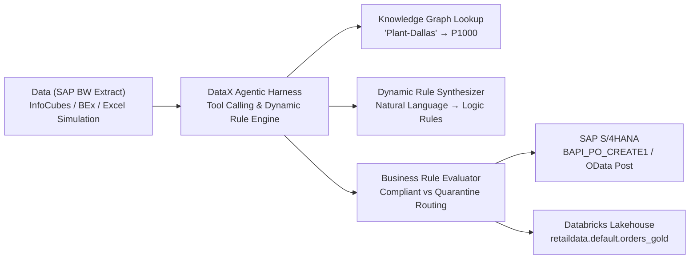

# DataGlow.ai — Enterprise Semantic Platform & DataX Decision Intelligence

Welcome to the **DataGlow.ai** company website and **DataX Platform** Decision Intelligence POC.

---

## 🌟 Executive Overview

DataGlow.ai delivers the enterprise semantic foundation and autonomous decision intelligence for Global 2000 data estates. We solve the fundamental problem of enterprise data opacity by unifying:
1. **Enterprise Ontologies & Knowledge Graphs**: Resolving multi-system semantic ambiguity across ERPs and warehouses.
2. **Agentic Harness & Tool Calling**: Autonomous goal-driven agents that reason, invoke verified enterprise tools, and execute self-correcting validation loops.
3. **Enterprise Modernization & Decision Intelligence**: Connecting legacy SAP BW / ECC into operational **SAP S/4HANA** transactions and analytical **Databricks Lakehouse** assets.

---

## 🚀 Two Production Products

| Product | Focus | Key Capabilities |
| :--- | :--- | :--- |
| **DataGlow Continuum** | Enterprise AI Data Readiness | Automated Data Quality Index (DQI), Dynamic Drift Forecasting, Cross-Model Consistency, Meridian Lineage Audit, and Remediation Agents. |
| **DataX Platform** | Decision Intelligence & Data Transformation | End-to-End Autonomous Transformation Pipeline: `SAP BW → Agentic Rule Engine (Tool Calling) → SAP S/4HANA → Databricks`. |

---

## 🏗️ Architecture: The DataX Transformation Pipeline



### Flow Breakdown
1. **Source Data (SAP BW)**:
   - Ingests raw batch extracts (e.g., InfoCube `0PUR_C01` procurement orders, stock ledger).
   - Simulates real-world legacy data quirks and anomalies using included Excel & CSV datasets (`sap_bw_procurement_extract.xlsx`, `sap_bw_inventory_extract.xlsx`).
2. **Agentic Business Validation (Agent Harness & Tool Calling)**:
   - Autonomous ReAct Agent Loop: `THOUGHT → TOOL_CALL → OBSERVATION → REFLECTION`.
   - **Tool `ontology_graph_lookup`**: Traverses knowledge graph to map legacy location strings (e.g., `Plant-Dallas` → `P1000`).
   - **Tool `dynamic_rule_synthesizer`**: Synthesizes domain business rules from business intent.
   - **Tool `business_rule_evaluator`**: Executes rules across the batch, quarantining violations (negative quantities, amount mismatches, missing vendors).
3. **Operational ERP Writeback (SAP S/4HANA)**:
   - **Tool `s4hana_payload_builder`**: Generates schema-compliant `BAPI_PO_CREATE1` / OData payloads.
   - Governance Gate: 1-Click human verification with budget ceiling safeguards.
   - Generates simulated SAP confirmation receipt (Document `#4500019284`, latency `38ms`).
4. **Analytical Lakehouse (Databricks)**:
   - **Tool `databricks_delta_writer`**: Persists compliant records into Databricks Unity Catalog (`retaildata.default.sap_bw_modernized_gold`).
   - Strict typing (BIGINT, DOUBLE, TIMESTAMP, native SQL NULLs) and partition pruning.

---

## 💻 Quick Start & Running Locally

### 1. Web Application (Company Website & Interactive DataX POC)

```bash
# Navigate to project directory
cd "h:\AAVIL Inc\DataX\DataX"

# Dependencies are already installed! Start development server:
npm run dev

# Or build production bundle:
npm run build
```

Open your browser at:
- `http://localhost:5173/` — **DataGlow.ai Company Website** (Hero, Products Showcase, Expertise, Architecture)
- `http://localhost:5173/#poc` — **Live Interactive DataX POC Platform**

### 2. Standalone Python Agent Harness

To run the autonomous agent tool-calling loop in your terminal:

```bash
python agent_harness.py
```

---

## 📂 Standardized Project Structure

```text
DataX/
├── backend/                       # Python FastAPI Backend Architecture
│   ├── service.py                 # Core FastAPI REST API application & routes
│   ├── agent_harness.py           # Autonomous Agent Harness daemon
│   ├── requirements.txt           # Python backend dependencies
│   ├── core/                      # Foundational infrastructure (DB pool, Vault, JWT, logger, sanitizer)
│   │   ├── db_config.py           # PostgreSQL/Neon storage connection manager
│   │   ├── db_pool.py             # High-throughput connection pooling
│   │   ├── jwt_config.py          # Cryptographic JWT secret configuration
│   │   ├── vault.py               # Fernet master-key envelope encryption
│   │   ├── structured_logger.py   # JSON logging & telemetry
│   │   └── sanitizer.py           # Zero-trust PII masking & prompt defense
│   ├── engines/                   # Analytical & AI Engines
│   │   ├── engine.py              # DuckDB-powered fast analytical rule engine
│   │   ├── ai_firewall_engine.py  # AI Firewall, RAG inspection & guardrails
│   │   ├── fmd_mapping_engine.py  # Field Mapping Document engine
│   │   ├── privacy_gateway_engine.py # Format-Preserving Encryption gateway
│   │   ├── ml_certification_engine.py# AI/ML bias, safety & explainability
│   │   └── siem_engine.py         # SIEM audit logging & Merkel hash chains
│   ├── pipeline/                  # Pipeline Orchestration & State
│   │   ├── pipeline.py            # End-to-end data pipeline orchestrator
│   │   ├── orchestrator.py        # Task graph coordinator
│   │   ├── checkpointer.py        # Crash-recovery stage checkpointer
│   │   ├── alerts.py              # Alerting, webhook dispatch & DLQ
│   │   ├── resilience.py          # Circuit breakers & idempotency manager
│   │   └── streamer.py            # Real-time chunked data streamer
│   ├── security/                  # Auth, RBAC & Licensing
│   │   ├── auth_engine.py         # Multi-tenant user auth & bcrypt hashing
│   │   ├── rbac_engine.py         # Role-based access control & IdP SSO
│   │   ├── license_engine.py      # Signed enterprise license verification
│   │   └── entitlements.py        # Feature quotas & usage metering
│   ├── connectors/                # Enterprise Connectors
│   │   ├── connectors.py          # Multi-database driver (Postgres, MSSQL, MySQL, Oracle)
│   │   └── connector_ecosystem.py # Catalog registry & health probes
│   ├── governance/                # Compliance & Management
│   │   ├── governance.py          # Policy enforcement & audit ledgers
│   │   ├── change_management.py   # Version diffs & approval workflows
│   │   ├── tenant_manager.py      # Organization & tenant isolation
│   │   └── sap_generator.py       # SAP domain packs & BAPI builders
│   └── models/                    # Pydantic Schemas & Schemas
│       └── models.py              # API models & serialization contracts
│
├── src/                           # React 18 / Vite Frontend Application
│   ├── components/                # Modular UI components & design system
│   ├── pages/                     # Application views (CleanFlow, Mapping Studio, AI Firewall)
│   ├── context/                   # React Context state providers (Auth, Navigation, RuleEngine)
│   └── services/                  # Frontend API clients, error ring-buffers & telemetry
│
├── tests/                         # Test & Verification Suites
│   ├── test_fmd_mapping_engine.py # FMD unit test suite
│   ├── egress_block_test.py       # Air-gapped zero-egress network leak audit
│   ├── benchmark.py               # Data pipeline performance benchmark
│   └── gateway_benchmark.py       # Privacy gateway throughput benchmark
│
├── docs/                          # Comprehensive Documentation
│   ├── AGENTS.md                  # Autonomous agent harness specification
│   ├── DATAX_BUSINESS_PROBLEM_AND_ARCHITECTURE.md
│   ├── DEMO_SCRIPT.md             # Product demo walkthrough
│   ├── TESTING_GUIDE.md           # Verification & test execution guide
│   └── roadmap/                   # Strategic enterprise roadmap & milestones
│
├── deploy/                        # Production & Container Manifests
│   ├── Dockerfile.backend         # Production Python 3.11 container
│   ├── Dockerfile.frontend        # Production Nginx frontend container
│   ├── nginx.conf                 # Production reverse-proxy config
│   └── helm/                      # Kubernetes Helm charts
│
├── scripts/                       # DevOps & Remote Maintenance Scripts
├── data/                          # Local persistent storage stores (.fmd_store.json, etc.)
├── public/                        # Static assets, branding, and sample data
├── service.py                     # Root compatibility shim
├── docker-compose.yml             # Local multi-service orchestration
└── package.json                   # Frontend dependencies & build commands
```
