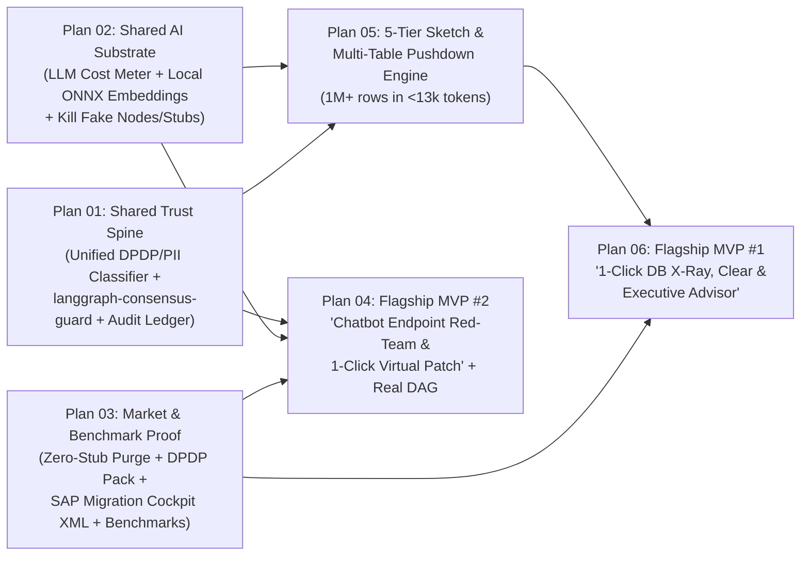

# Sprint 1 Master Architecture & Research Roadmap
**Source Backlog:** [`sprint1.md`](file:///h:/AAVIL%20Inc/DataX/DataX/sprint1.md) (Items 1–9)

---

## 1. Item-by-Item Traceability Matrix (`sprint1.md` → Individual Plans)

Items addressing the exact same architectural or market concern have been combined where appropriate so there is zero duplication, while preserving dedicated deep-dive plans for each distinct technical initiative:

| `sprint1.md` Line | Topic Summary | Dedicated Plan Document | Why Grouped / Separated |
| :---: | :--- | :--- | :--- |
| **Line 1** | The 4 current subdomains (*Database & ERP*, *AI Agent & Firewall*, *ML Training & Drift Gate*, *FMD Mapping & BODS Staging*) | [**Plan 01 — Suite Coherence & Architecture**](file:///h:/AAVIL%20Inc/DataX/DataX/docs/sprint1/01_suite_coherence_and_architecture.md) | Lines 1 & 2 ask whether the 4 modules form a coherent Microsoft-style ecosystem and how they should connect. |
| **Line 2** | Do these 4 submodules cumulatively make sense like Microsoft's suite? | [**Plan 01 — Suite Coherence & Architecture**](file:///h:/AAVIL%20Inc/DataX/DataX/docs/sprint1/01_suite_coherence_and_architecture.md) | Combined with Line 1; defines the shared **DataX Trust Spine** + horizontal renaming of FMD/BODS. |
| **Line 3** | True status & full pipeline for RAG, agent harness, ingestion, chunking, processing & embeddings per submodule | [**Plan 02 — RAG, Harness, Ingestion & Embedding Pipeline**](file:///h:/AAVIL%20Inc/DataX/DataX/docs/sprint1/02_rag_harness_ingestion_embedding_pipeline.md) | Standalone cross-cutting technical audit (with `file:line` truth table) + unified `pgvector` + ONNX + LangGraph substrate + LLM cost breaker. |
| **Line 4** | Lacking factors preventing market valuation | [**Plan 03 — Market Gaps, Competitors & Innovation**](file:///h:/AAVIL%20Inc/DataX/DataX/docs/sprint1/03_market_gaps_competitors_and_innovation.md) *(Part 1)* | Valuation gaps (#4), competitor strengths (#5), and defensible differentiation (#6) form one tight strategic triad, each given its own full section. |
| **Line 5** | Competitive products & how they beat us today | [**Plan 03 — Market Gaps, Competitors & Innovation**](file:///h:/AAVIL%20Inc/DataX/DataX/docs/sprint1/03_market_gaps_competitors_and_innovation.md) *(Part 2)* | Covers Monte Carlo, Informatica, Cyera, Lakera/Check Point, Prisma AIRS, Promptfoo, Evidently, Arize, Syniti, SNP Kyano. |
| **Line 6** | How to do things differently that qualifies as true innovation | [**Plan 03 — Market Gaps, Competitors & Innovation**](file:///h:/AAVIL%20Inc/DataX/DataX/docs/sprint1/03_market_gaps_competitors_and_innovation.md) *(Part 3)* | Defines 5 defensible moats (`±2.5` Mathematical Consensus, Sketch-First Zero-Token DB Scan, Red-Team→Virtual-Patch loop, FMD Compiler, DPDP 2025 Sovereign Pack). |
| **Line 7** | Real (non-fake) nodes & templates across all 4 modules — e.g., Customer Chatbot Endpoint Red-Team, Vulnerability Analysis & Fix | [**Plan 04 — Dynamic Nodes & Endpoint Red-Team Templates**](file:///h:/AAVIL%20Inc/DataX/DataX/docs/sprint1/04_dynamic_nodes_and_endpoint_redteam_templates.md) | Standalone engineering plan for the typed DAG node contract + full 7-node Customer Chatbot Endpoint Red-Team & Virtual Patch architecture. |
| **Line 8** | Solving 1M+ row & multi-table reading in DB/ERP without wasting LLM tokens | [**Plan 05 — Million-Row Zero-Token Table Intelligence**](file:///h:/AAVIL%20Inc/DataX/DataX/docs/sprint1/05_million_row_zero_token_table_intelligence.md) | Standalone deep systems/math plan ($O(\text{columns})$ token scaling via Catalog + Pushdown Sketches + MinHash Join Graph + Shape Masking + Pushdown SQL). |
| **Line 9** | **"One-Click DB Clear & Executive Business Advisor"** MVP powered by innovative table reading + DataGlow + agentic orchestration | [**Plan 06 — One-Click DB X-Ray, Clear & Executive Advisor MVP**](file:///h:/AAVIL%20Inc/DataX/DataX/docs/sprint1/06_one_click_db_clear_and_executive_advisor_mvp.md) | Standalone flagship MVP product plan building directly on Plan 05 + `nexlayer-backend` (DataGlow) + `langgraph-consensus-guard`. |

---

## 2. Dependency Graph & Recommended Execution Order

### Recommended Sequencing
1. **Foundation Week (Must Do First — Protects Cost & Trust):**
   - Lock down `vite.config.js` `envPrefix` + ship `backend/core/llm_gateway.py` (hard per-tenant token/INR budget cap & cache so Azure Foundry bills can never spike again) — **Plan 02**.
   - Purge fake/hardcoded connector success responses (`connectors.py:147-198`, `/v1/embeddings` SHA-256 stub, CleanFlow `vector_matcher`/`rag` stubs) and extract the shared **Global + India DPDP PII Checksum Classifier** + **`langgraph-consensus-guard`** spine — **Plans 01, 02, 03**.
2. **Track 1 Flagship Build (Weeks 1–3):** **Plan 05 $\to$ Plan 06 (*One-Click DB X-Ray, Clear & Executive Advisor*)** — reuses DataGlow (`nexlayer-backend/metrics/`) and gives you a universal 3-minute enterprise demo on any Postgres/MSSQL/MySQL/Snowflake/Databricks DB.
3. **Track 2 Flagship Build (Parallel or Weeks 2–4):** **Plan 04 (*Customer Chatbot Endpoint Vulnerability Analyzer & 1-Click Virtual Patch*)** — turns AI Firewall from passive regexes into an active "Break $\to$ Patch $\to$ Verify" security product.
4. **Track 3 SAP Commercial Acceleration (Parallel 1-Week Sprint):** Add **SAP S/4HANA Migration Cockpit XML/CSV export** + PDF spec hybrid RAG (`pgvector` + `fastembed`) to FMD Studio — **Plans 02, 03, 04**.

---

## 3. Locked Decisions & Sprint Execution Rules (Confirmed 2026-11-25)

1. **Execution Cadence:** No rushed pitch deadline — execute **one plan/milestone at a time** cleanly, starting with **Step 1 (Foundation: LLM Cost Breaker, `vite.config.js` secret-prefix fix, Shared PII/DPDP Spine, and Zero-Stub Connector Cleanup)** before layering feature modules.
2. **Database & ERP Test Environments:** Use local Dockerized engines (`PostgreSQL 16`, `MySQL 8`, `SQL Server 2022 Developer`, `MongoDB 7`), DuckDB/TPC-H 1M-row generators, official public read-only SQL demo databases, and legitimate free trial sandboxes (Snowflake / Databricks) — zero reliance on hardcoded mock responses.
3. **Microservice Architecture Boundary:** Keep **DataX** (`port 8003`) and **DataGlow / `nexlayer-backend`** (`port 8000`) as **separate microservices** communicating via versioned REST/HTTP APIs (sharing only standalone installable packages such as `langgraph-consensus-guard`).
4. **Production VM Telemetry (`20.193.248.164` / `dataglow.ai`):**
   - Verified via live API telemetry (`/datax-api/storage/info`): On-prem PostgreSQL is active on `127.0.0.1:5432` (`database=datax`, `ON_PREM_SELF_HOSTED`, 12 tables initialized).
   - Note: Direct SSH from this workstation requires an SSH key in `~/.ssh` (or the post-incident rotated VM password), and GitHub Actions Secrets (`AZURE_VM_PASSWORD` / `AZURE_VM_SSH_KEY`) should match the rotated VM credentials for automated deploys.
5. **Module 4 Horizontal Renaming Approved:** Rename *"FMD Mapping & BODS Staging"* in navigation and product surfaces to **"Schema & Migration Studio"**, featuring *SAP S/4HANA FMD → Migration Cockpit & BODS* as Certified Domain Accelerator #1.
