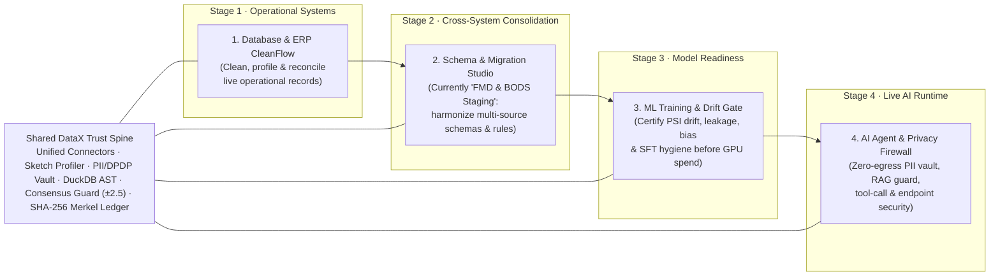

# Plan 01 — Ecosystem Coherence & Suite Architecture
**Addresses `sprint1.md` Items 1 & 2:**
- *Item 1:* "We have 4 sub domains as of now: Database & ERP, AI Agent & Firewall, ML training & drift gate, FMD mapping and BODS staging."
- *Item 2:* "I want you to list down if these sub modules cumulatively make sense, just like Microsoft has its environment like Azure, Word, etc. — do these sub modules make sense?"

---

## 1. Direct Verdict: Do the 4 Submodules Cumulatively Make Sense?

**Conceptually: YES — with one critical repositioning.**  
**Architecturally (in code today): NOT YET — they currently operate as 4 separate apps sharing a navbar.**

### Why Microsoft's Ecosystem Works (The Benchmark Test)
Microsoft 365 (Word, Excel, PowerPoint, Teams) and Azure (Entra ID, Purview, Fabric, Foundry) make cumulative sense to buyers for three structural reasons:
1. **One Shared Backbone:** One identity (`Entra ID`), one file/data substrate (`OneDrive / SharePoint / OneLake`), and one governance plane (`Purview`). An artefact created in Excel flows natively into PowerPoint, Teams, and Copilot without re-uploading or re-authenticating.
2. **Horizontal Product Names, Vertical Templates:** Microsoft sells **Excel** (horizontal engine), not *"SAP Material Master 4-Sheet Merger."* Industry-specific workflows ship as **Templates / Accelerators** on top of the horizontal engine.
3. **Wedge-First Adoption, Suite Expansion:** Customers rarely buy all of Azure on Day 1. They buy one painful wedge (e.g., Office or Active Directory), trust the substrate, and expand into adjacent modules because switching data planes is harder than turning on the next module.

---

## 2. Mapping DataX's 4 Subdomains Onto One Unifying Narrative

If pitched as *"a database cleaner + an LLM firewall + an ML drift checker + an SAP BODS Excel mapper"*, buyers get confused because those sound like 4 unrelated tools for 4 different departments.

If unified under **one thesis — The Enterprise Data-to-AI Trust & Control Plane**, every submodule becomes a mandatory checkpoint along the **exact lifecycle of enterprise data**:

### Submodule-by-Submodule Coherence Audit

| # | Current Name | Target Buyer Persona | Fits the Suite? | The Structural Problem Today | Required Reframing |
| :--- | :--- | :--- | :---: | :--- | :--- |
| **1** | **Database & ERP** | Head of Data Engineering / ERP Lead | **Yes (Foundation)** | Real only for Postgres & MongoDB ([`connectors.py:63-128`](file:///h:/AAVIL%20Inc/DataX/DataX/backend/connectors/connectors.py#L63-L128)); SAP/Snowflake/Databricks fall back to hardcoded SAP sample tables ([`connectors.py:158-198`](file:///h:/AAVIL%20Inc/DataX/DataX/backend/connectors/connectors.py#L158-L198)). | Make this the **Universal Data & ERP Posture + CleanFlow Layer** (powers One-Click DB Clear in Plan 06). |
| **2** | **FMD Mapping & BODS Staging** | SAP Program Director / System Integrator (SI) | **Yes — IF renamed horizontally** | Named after *one client's legacy ETL stack* (`SAP BODS` + `TIME R3.2 MAKT-MAKTX`). Furthermore, SAP itself is phasing out BODS in favor of S/4HANA Migration Cockpit & Syniti ADMM. | Rename horizontal module to **Enterprise Migration & Schema Studio**. Package *SAP S/4HANA FMD + Migration Cockpit + BODS (`Z_ERRORLOG`)* as **Certified Domain Accelerator #1**. |
| **3** | **ML Training & Drift Gate** | MLOps Lead / Chief Risk Officer | **Yes (Pre-Training Gate)** | Strong real math ([`ml_certification_engine.py:98-285`](file:///h:/AAVIL%20Inc/DataX/DataX/backend/engines/ml_certification_engine.py#L98-L285): 10-bin PSI, Pearson leakage, 4/5ths parity, SFT scrubber), but isolated — cannot pull directly from CleanFlow or Migration Studio outputs without re-querying. | Wire directly downstream of Database & Migration outputs so a cleaned ERP table can be **1-click ML-certified** and registered in MLflow / Databricks Unity Catalog. |
| **4** | **AI Agent & Firewall** | CISO / Head of AI Platform | **Yes (Runtime Gate)** | Strong AES-GCM FPE `TokenVault` ([`privacy_gateway_engine.py:117-260`](file:///h:/AAVIL%20Inc/DataX/DataX/backend/engines/privacy_gateway_engine.py#L117-L260)), but regex-only detection, US-centric PII (missing Aadhaar/PAN/GSTIN), and no active red-teaming of customer endpoints. | Position as **Runtime AI & MCP Guard + Continuous Red-Team** reading from the same PII & Ontology policies defined in Stage 1. |

---

## 3. Codebase Reality Check: Why They Feel Disconnected Today

1. **Four Separate Canvases & Node Schemas:**
   - CleanFlow uses [`WorkflowCanvasBuilder.jsx`](file:///h:/AAVIL%20Inc/DataX/DataX/src/components/cleanflow/WorkflowCanvasBuilder.jsx) + [`nodeCatalog.js`](file:///h:/AAVIL%20Inc/DataX/DataX/src/components/cleanflow/constants/nodeCatalog.js).
   - AI Firewall uses [`AiFirewallCanvas.jsx`](file:///h:/AAVIL%20Inc/DataX/DataX/src/components/firewall/AiFirewallCanvas.jsx) + [`firewallCatalog.js`](file:///h:/AAVIL%20Inc/DataX/DataX/src/components/firewall/firewallCatalog.js).
   - ML Gate uses [`MlGateCanvas.jsx`](file:///h:/AAVIL%20Inc/DataX/DataX/src/components/mlgate/MlGateCanvas.jsx) + [`mlGateCatalog.js`](file:///h:/AAVIL%20Inc/DataX/DataX/src/components/mlgate/mlGateCatalog.js).
   - FMD Studio uses [`FmdCanvasStudio.jsx`](file:///h:/AAVIL%20Inc/DataX/DataX/src/components/mapping/FmdCanvasStudio.jsx).
   - *Consequence:* Fixing a bug or adding a PostgreSQL source node requires editing 4 places. You cannot build a cross-domain pipeline (e.g., *Extract Postgres $\to$ Map FMD $\to$ Certify ML Drift $\to$ Sanitize for RAG*).
2. **Four Duplicate PII & Audit Implementations:**
   - Regexes for `SSN`, `CREDIT_CARD`, `EMAIL` are duplicated across [`ai_firewall_engine.py:35-38`](file:///h:/AAVIL%20Inc/DataX/DataX/backend/engines/ai_firewall_engine.py#L35-L38), [`consensus_engine.py:15-17`](file:///h:/AAVIL%20Inc/DataX/DataX/backend/engines/consensus_engine.py#L15-L17), [`sanitizer.py`](file:///h:/AAVIL%20Inc/DataX/DataX/backend/core/sanitizer.py), and `nexlayer-backend/metrics/governance.py`.
   - Audit logs are fragmented across `.audit_hash_chain.jsonl`, `datax_firewall_events`, `datax_gateway_audit`, `datax_ml_certifications`, and `.fmd_store.json`.
3. **Split Brain Across Sibling Repos:**
   - `h:\AAVIL Inc\DataX\DataX` has the polished SaaS UI, FMD engine, ML PSI gate, and AES-GCM Privacy Gateway.
   - `h:\AAVIL Inc\DataX\nexlayer-backend` (**DataGlow / SCAIDR**) has the real LangGraph multi-agent state machine, Qdrant GraphRAG, Databricks SQL writer, MCP servers, and Langfuse/RAGAS evals.
   - `h:\AAVIL Inc\DataX\langgraph-consensus-guard` has the clean, typed, PyPI-packaged 3-layer mathematical anchoring library (`±2.5` band), while DataX runs an older inline copy ([`consensus_engine.py`](file:///h:/AAVIL%20Inc/DataX/DataX/backend/engines/consensus_engine.py)).

---

## 4. Go-To-Market Suite vs. Wedge Strategy (Crucial Business Decision)

Even Microsoft didn't launch Azure + Office + Defender simultaneously. For AAVIL / DataGlow + DataX:
- **Platform Architecture (Internal):** Build **one shared spine** powering all 4 modules so engineering compounds once.
- **Sales Motion (External — "Land with 1 Sharp Wedge, Expand into the Suite"):**
  - **Wedge A (For Enterprises / Mid-Market CTOs & CISOs):** **One-Click DB X-Ray & Clear + AI Privacy Firewall** (DPDP 2025 compliance + AI readiness in 3 minutes on any Postgres/MSSQL/MySQL/SAP DB).
  - **Wedge B (For SAP S/4HANA Migrations & Global SIs like Deloitte/Accenture/Wipro/Infosys):** **Migration & FMD Consolidation Studio** (ahead of the Dec 31, 2027 SAP ECC maintenance deadline).
  - **Expansion Modules (Upsell on the same contract & data connection):** **CleanFlow Continuous Pipelines** + **ML Training & SFT Certification Gate**.

---

## 5. Required Research & Validation Before Execution

1. **Buyer Persona & Packaging Discovery (Product Research — 1 week):**
   - Interview 5 target buyers (2 SAP migration leads, 2 CISO/DPOs dealing with India DPDP 2025, 1 Head of Data/AI) with two pitch decks: *"4-Pillar Suite"* vs *"Single Wedge + Modular Add-ons"* — measure which gets a pilot commitment faster.
   - Validate naming: test *"Migration & Schema Studio (with SAP S/4HANA & BODS Pack)"* vs *"FMD & BODS Studio"* with non-SAP enterprise prospects to confirm broader resonance without losing SAP credibility.
2. **Shared Spine Technical Spike (Engineering Research — 3 days):**
   - Design a single canonical **`DataXArtifact` / Dataset Handle** contract (`uri | parquet_checkpoint | duckdb_relation`, schema manifest, PII classification map, SHA-256 lineage parent) so the output of Module 1 or Module 2 can be opened directly in Module 3 (ML Gate) or Module 4 (RAG Firewall) with zero re-upload.
   - Audit schema compatibility between `DataX` and `nexlayer-backend` (`data/checkpoints/run_{id}.parquet`) and `langgraph-consensus-guard` (`Layer1MetricResult`, `ConsensusVerdict`) to unify DataGlow + DataX on one core library instead of maintaining forks.
3. **Unified Audit & Policy Schema Research (Compliance Research — 2 days):**
   - Map common audit fields required simultaneously by **India DPDP Rules 2025** (72-hour breach auditability, consent/purpose tags), **EU AI Act Art. 10** (training data governance), **SOX 404** (financial lineage), and **SOC 2 CC6/CC7** into a single Merkle-chained ledger table (`datax_unified_audit_ledger`).

---

## 6. Actionable Implementation Roadmap

1. **Phase 1 — Shared Core Extraction (`backend/spine/`):**
   - Extract one **Unified PII & Sensitive Entity Classifier** (US + EU + India DPDP entities: Aadhaar Verhoeff, PAN, GSTIN, UPI, IFSC) used identically by DB Profiler, CleanFlow, ML Gate, and AI Firewall.
   - Replace inline [`consensus_engine.py`](file:///h:/AAVIL%20Inc/DataX/DataX/backend/engines/consensus_engine.py) with the canonical [`langgraph-consensus-guard`](file:///h:/AAVIL%20Inc/DataX/langgraph-consensus-guard/README.md) package.
   - Consolidate the 5 separate audit stores into one tenant-scoped Merkle ledger with module tags (`DB_ERP | MIGRATION | ML_GATE | AI_FIREWALL`).
2. **Phase 2 — Cross-Module Handoffs ("1-Click Send To..."):**
   - From **Database & ERP** or **Migration Studio**, add *"Certify for ML Training →"* and *"Index Safely for RAG →"* buttons that pass the staged dataset reference directly into ML Gate / AI Firewall.
3. **Phase 3 — Reposition Module 4 UI & Docs:**
   - Rename top-level navigation from *"FMD & BODS Staging"* to *"Schema & Migration Studio"*, featuring *SAP S/4HANA FMD → BODS / Migration Cockpit* as the flagship certified pack alongside *Legacy ERP → Snowflake/Databricks* and *Multi-CRM Consolidation*.
