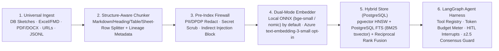

# Plan 02 — RAG, Agent Harness, Ingestion, Chunking & Embedding Pipeline
**Addresses `sprint1.md` Item 3:**
- *Item 3:* "I want to know if implemented RAG, harness, ingestion (chunking), processing, embedding of each submodule — the whole pipeline for this."

---

## 1. Ground-Truth Audit: What Is Actually Implemented Today vs. Simulated

Before designing Sprint 1 work, here is the **exact, line-cited truth** of every pipeline stage across `DataX` and what already exists in your sibling repo `nexlayer-backend` (**DataGlow / SCAIDR**) that we can immediately port/share:

### A. Stage-by-Stage Audit Across the 4 Submodules in `DataX`

| Pipeline Stage | 1. Database & ERP | 2. AI Agent & Firewall | 3. ML Training & Drift Gate | 4. FMD Mapping & Staging | Reusable Asset in `nexlayer-backend` / Siblings |
| :--- | :--- | :--- | :--- | :--- | :--- |
| **Ingestion** | **Real** for Postgres & MongoDB ([`connectors.py:63-128`](file:///h:/AAVIL%20Inc/DataX/DataX/backend/connectors/connectors.py#L63-L128), [`streamer.py:18`](file:///h:/AAVIL%20Inc/DataX/DataX/backend/pipeline/streamer.py#L18)). **Simulated** for SAP HANA (TCP ping + hardcoded 6 tables, [`connectors.py:147-166`](file:///h:/AAVIL%20Inc/DataX/DataX/backend/connectors/connectors.py#L147-L166)) and all other DBs (`else:` returns hardcoded SAP tables, [`connectors.py:179-198`](file:///h:/AAVIL%20Inc/DataX/DataX/backend/connectors/connectors.py#L179-L198)). | **Real**: PDF/DOCX/TXT upload, Postgres/Mongo column extractor, & SSRF-safe URL fetcher ([`studio_io_engine.py:72-249`](file:///h:/AAVIL%20Inc/DataX/DataX/backend/engines/studio_io_engine.py#L72-L249)). | **Real**: Tabular CSV/JSON/DB records + JSONL SFT prompt/completion pairs ([`ml_certification_engine.py:433`](file:///h:/AAVIL%20Inc/DataX/DataX/backend/engines/ml_certification_engine.py#L433)). | **Real & Strong**: `.xlsx/.xls/.csv/.numbers/.ods/.json/.pdf/.pptx/.docx` via IndexedDB + [`document_processor.py:226-404`](file:///h:/AAVIL%20Inc/DataX/DataX/backend/governance/document_processor.py#L226-L404) with zip-bomb & DDE guards. | **Real** Databricks SQL, Snowflake MCP, S3 MCP, BigQuery MCP (`nexlayer-backend/connectors/`, `Decision-Intelligence-Platform/.../nodes/db/`). |
| **Chunking** | Row batching (`chunk_size=5000` cursor in [`streamer.py:23`](file:///h:/AAVIL%20Inc/DataX/DataX/backend/pipeline/streamer.py#L23)), but [`pipeline.py:374`](file:///h:/AAVIL%20Inc/DataX/DataX/backend/pipeline/pipeline.py#L374) `fetched.extend(chunk)` materializes all rows into RAM. | **Real (Basic)**: Fixed character sliding window (`chunk_size=1200, overlap=120`, [`ai_firewall_engine.py:379-382`](file:///h:/AAVIL%20Inc/DataX/DataX/backend/engines/ai_firewall_engine.py#L379-L382)). Not structure/heading/table aware. | Not applicable for tabular; SFT pairs processed per JSONL line. | Spreadsheets parsed per sheet/row; PDFs split per page, PPTX per slide, DOCX per paragraph — **capped at 100 chunks** ([`document_processor.py:389-402`](file:///h:/AAVIL%20Inc/DataX/DataX/backend/governance/document_processor.py#L389-L402)). | `nexlayer-backend/agent/nodes/ingest_unstructured.py` & `backend/api/routes/unstructured.py`. |
| **Processing** | **Real**: DuckDB SQL AST rule evaluation + 3-tier deterministic remediation ([`engine.py:51-265`](file:///h:/AAVIL%20Inc/DataX/DataX/backend/engines/engine.py#L51-L265)). | **Real**: Regex PII/secret/injection scrub + Shannon entropy + AES-GCM FPE `TokenVault` ([`privacy_gateway_engine.py:117-441`](file:///h:/AAVIL%20Inc/DataX/DataX/backend/engines/privacy_gateway_engine.py#L117-L441)). | **Real**: 10-bin quantile PSI, Pearson leakage, 4/5ths demographic parity, median/mode imputation, IQR clipping ([`ml_certification_engine.py:98-430`](file:///h:/AAVIL%20Inc/DataX/DataX/backend/engines/ml_certification_engine.py#L98-L430)). | **Real**: Multi-workbook consolidation, coverage heatmap, version diff (`R3.2→R3.3`), DuckDB XREF SQL simulator, ARC-01 staging ([`fmd_mapping_engine.py:1180-1934`](file:///h:/AAVIL%20Inc/DataX/DataX/backend/engines/fmd_mapping_engine.py#L1180-L1934)). | `nexlayer-backend/metrics/` (DQI engine) + `langgraph-consensus-guard` (`±2.5` mathematical anchoring). |
| **Embeddings** | **FAKE / STUBBED**: `vector_matcher` node in [`pipeline.py:161-174`](file:///h:/AAVIL%20Inc/DataX/DataX/backend/pipeline/pipeline.py#L161-L174) passes rows unchanged and prints fake `text-embedding-3-small` log. | **FAKE / STUBBED**: `/v1/embeddings` ([`service.py:2157-2187`](file:///h:/AAVIL%20Inc/DataX/DataX/backend/service.py#L2157-L2187)) hashes text with `SHA-256` into 128 pseudo-floats — zero semantic similarity! `datax_verified_rag_chunks` stores `clean_text` only, no vector column. | **Missing**: No embedding-based semantic drift or near-duplicate SFT detection. | **Missing**: Uploaded PDF/PPTX/DOCX `text_chunks` are never embedded; fuzzy column matching is string/header rule-based. | **Real** Azure OpenAI `text-embedding-3-small` + **Qdrant** vector indexing in `nexlayer-backend/chatbot/` & `evals/`. |
| **RAG (Retrieval + Grounded Gen)** | **FAKE / STUBBED**: `rag` node in [`pipeline.py:175-185`](file:///h:/AAVIL%20Inc/DataX/DataX/backend/pipeline/pipeline.py#L175-L185) returns 2 hardcoded SOX strings. Rule gen (`POST /rules/generate`, [`service.py:1151`](file:///h:/AAVIL%20Inc/DataX/DataX/backend/service.py#L1151)) is direct prompt + 3 sample rows (no retrieval). | **Pre-RAG Guard Only**: Sanitizes chunks *before* RAG, but does not index into `pgvector`/Qdrant or perform retrieval. | **None**: No retrieval over model cards or regulatory policy docs. | **Structured Lookup + LLM (Partial RAG)**: `POST /fmd/ask` ([`fmd_mapping_engine.py:1073`](file:///h:/AAVIL%20Inc/DataX/DataX/backend/engines/fmd_mapping_engine.py#L1073)) matches `TABLE-FIELD` deterministically and feeds matching rows to `gpt-5-mini` with exact sheet/row citations. Unstructured spec PDFs are not retrieved. | **Real GraphRAG + Qdrant + RAGAS evals** in `nexlayer-backend/chatbot/tools/search_tools.py` & `evals/layer2_graphrag/`. |
| **Agent Harness** | **SCRIPTED STUB**: [`agent_harness.py:32-200`](file:///h:/AAVIL%20Inc/DataX/DataX/backend/agent_harness.py#L32-L200) is a deterministic 5-step Python script with hardcoded rules and fake Databricks latency. | In-flight tool-call *interceptor* is real ([`ai_firewall_engine.py:455+`](file:///h:/AAVIL%20Inc/DataX/DataX/backend/engines/ai_firewall_engine.py)), but no agent loop for probing/red-teaming. | Inline Layer 1-2-3 math in [`consensus_engine.py`](file:///h:/AAVIL%20Inc/DataX/DataX/backend/engines/consensus_engine.py) uses rule formulas, not live LLM domain voters. | Single-shot LLM call in `/fmd/ask`; no multi-step agent loop. | **Real LangGraph StateGraph** with HITL `interrupt()`, 6 domain LLM agents, and checkpoints in `nexlayer-backend/agent/graph.py`! |

> **Security & Cost Alert Found During Audit:**
> 1. [`vite.config.js:6`](file:///h:/AAVIL%20Inc/DataX/DataX/vite.config.js#L6) sets `envPrefix: ['VITE_', 'PINECONE_', 'AZURE_', 'BIGQUERY_', 'DATABRICKS_', 'SALESFORCE_', 'AWS_']`. Any matching env var at build time gets bundled into client-side JS! Restrict `envPrefix` strictly to `['VITE_']`.
> 2. There is **no centralized LLM gateway / token meter** inside `DataX` — calls to `AzureOpenAI` happen directly in `service.py` and `fmd_mapping_engine.py` without per-tenant daily token caps or semantic prompt caching (directly relevant to your recent Azure Foundry cost spike).

---

## 2. Target End-to-End Pipeline Architecture Across All 4 Submodules

We should **not** build 4 separate RAG/agent stacks. We build **one shared 6-stage AI Substrate (`backend/ai_substrate/`)** and plug each submodule into it:

### Why `pgvector` + Local Embeddings First (Critical Cost & Ops Choice)
- **Zero Extra Infrastructure:** DataX already runs PostgreSQL 16 ([`docker-compose.yml:5`](file:///h:/AAVIL%20Inc/DataX/DataX/docker-compose.yml#L5)). Enabling `CREATE EXTENSION IF NOT EXISTS vector;` + native `tsvector` gives us **Hybrid Search (Dense HNSW + BM25 Lexical + Metadata Filter)** in the exact same database with tenant isolation (`tenant_id`), zero Pinecone/Qdrant cloud bills, and 100% air-gap compatibility! (Optional Qdrant/Pinecone sink connectors remain available as external export nodes.)
- **Zero Foundry Token Drain for Bulk Embeddings:** Running a quantized local embedding model (`BAAI/bge-small-en-v1.5` or `sentence-transformers/all-MiniLM-L6-v2` via `fastembed` / ONNX Runtime — ~33M params, runs on CPU at ~500 chunks/sec, 0 GPU required!) means indexing 50,000 RAG chunks or matching 10,000 vendor names costs **₹0.00 in Azure Foundry API fees** and passes the air-gap egress test! Cloud embeddings (`text-embedding-3-small`) become an optional BYOK toggle.

### How Each of the 4 Submodules Uses This Exact Pipeline

| Submodule | What Gets Ingested & Chunked | How Embeddings & Hybrid RAG Are Used | What the LangGraph Agent Harness Executes |
| :--- | :--- | :--- | :--- |
| **1. Database & ERP** | Schema DDL, `pg_stats` column digests, data dictionaries, SOX/DPDP policy docs, distinct ontology values (plant/vendor names). *Never raw million-row tables!* | **Entity Resolution (`vector_matcher`)**: Embeds *distinct* vendor/plant/material strings only (e.g., 2,000 unique vendors out of 1M rows) to cluster `"IBM Corp"` $\leftrightarrow$ `"Intl Business Machines"`. **Policy RAG (`rag`)**: Retrieves relevant domain rules & DPDP/SOX clauses for the detected schema. | Plans schema profiling $\to$ synthesizes DuckDB/pushdown SQL rules $\to$ self-corrects failing SQL in dry-run $\to$ pauses at HITL gate for Tier-3 financial anomalies. |
| **2. AI Agent & Firewall** | Enterprise KB docs (PDF/DOCX/Confluence/URLs), company policy handbooks, agent tool schemas, historical attack signatures. | **Sanitized RAG Indexing (`vector_sink`)**: Chunks pass through `scan_rag_batch` $\to$ clean chunks get real vectors written to `datax_verified_rag_chunks(embedding vector(384))` or external Pinecone/Qdrant. **Semantic Injection Guard**: Cosine similarity against known jailbreak/indirect-injection embeddings catches paraphrased attacks that bypass regexes. | Runs **Adversarial Red-Team Loop** against customer chatbot endpoints (Plan 04): retrieves company context $\to$ generates multi-turn probes $\to$ evaluates responses $\to$ compiles gateway patch. |
| **3. ML Training & Drift Gate** | Tabular feature profiles, SFT JSONL `(prompt, completion)` corpora, historical baseline manifests, EU AI Act / RBI model risk guidelines. | **SFT Semantic Deduplication & Contamination Check**: Embeds SFT prompts via local ONNX to catch near-duplicate instruction pairs (cosine $> 0.92$) and **train/eval benchmark leakage**! **Embedding Drift**: Computes centroid/MMD shift on unstructured text datasets where 10-bin numeric PSI doesn't apply. | Orchestrates Tabular/SFT profiler $\to$ Domain Voter Agents (Drift, Leakage, Fairness, Hygiene) $\to$ `langgraph-consensus-guard` $\pm 2.5$ judge $\to$ signs SHA-256 Release Card. |
| **4. Migration & FMD Studio** | Multi-tab FMD Excel workbooks (1 row = 1 structured chunk with `file/sheet/row` metadata), XREF tables, **plus unstructured PDF/DOCX/PPTX design specs** (e.g., `TIME_R3.2_Spec`). | **Hybrid Spec + Workbook RAG (`/fmd/ask` & Auto-Mapper)**: Combines exact `TABLE-FIELD` lookup with hybrid BM25+vector retrieval over uploaded PDF/PPTX design specs (removing the 100-chunk cap in [`document_processor.py:402`](file:///h:/AAVIL%20Inc/DataX/DataX/backend/governance/document_processor.py#L402)) + semantic source-to-target column matching when legacy column names are cryptic (`ZZ_MAT_DESC1` $\to$ `MAKTX`). | Multi-step Migration Architect Agent: parses all uploaded FMDs + PDFs $\to$ detects cross-system conflicts $\to$ compiles DuckDB/SQL $\to$ runs sandbox simulation $\to$ routes `REWORK` items to HITL queue. |

---

## 3. Central LLM Gateway & Cost-Explosion Prevention (`backend/core/llm_gateway.py`)

To guarantee you **never** experience surprise Azure Foundry bills again, every single LLM/embedding call across DataX must go through one wrapper:
1. **Default Cheap/Local Routing:** Tier-0 tasks (embeddings, PII NER, language detection, semantic dedup) run on **local CPU ONNX** (`₹0`). Tier-1 structured tasks (rule synthesis, SQL generation, FMD Q&A) use `gpt-4o-mini` / `gpt-5-mini` with `max_completion_tokens` hard caps. Tier-2 executive synthesis runs once per job, never per row!
2. **Row-Loop Guardrail (Hard Assertion):** Reject any call attempting to invoke an LLM inside a row loop ($N > 25$ calls per request raises `TokenBudgetViolationError`).
3. **Content-Addressed SQLite/Postgres Semantic Cache:** Hash `(model, system_prompt_hash, normalized_user_payload_hash)` — identical demo/test runs cost **0 tokens**.
4. **Per-Tenant Daily Token & INR/USD Budget Breaker:** Persisted in `data/.meter_store.json` / Postgres; auto-trips to deterministic fallback when daily spend exceeds threshold (e.g., ₹500/day in dev, configurable per tenant).

---

## 4. Required Research & Technical Spikes

1. **Local Embedding Model Benchmark on Azure VM CPU (2 days):**
   - Benchmark `fastembed` (`BAAI/bge-small-en-v1.5`, 384-dim, ~130 MB RAM) vs `nomic-embed-text-v1.5` (Matryoshka 256/512-dim) on the production VM's exact vCPU/RAM budget (`service.py:257` currently alerts at 512 MB RSS — verify whether we raise RSS threshold to 1.5 GB or run embeddings in a shared worker).
   - Measure accuracy on SAP cryptic column matching (`LIFNR ↔ vendor_id`, `WERKS ↔ plant_code`, `MAKTX ↔ material_description`) and SFT near-duplicate detection.
2. **Structure-Aware Document Chunking Spike (2 days):**
   - Compare `Docling` (IBM open-source PDF table/layout parser) vs `pypdf + python-docx` recursive markdown/section chunking for enterprise PDF mapping specs containing embedded tables (standard fixed 1200-char chunking slices PDF tables in half, destroying rule context).
3. **Hybrid Retrieval (`pgvector` + `tsvector` RRF) Evaluation with RAGAS (2 days):**
   - Port the RAGAS harness from `nexlayer-backend/evals/layer2_graphrag/test_ragas_retrieval.py` and measure *Context Precision*, *Faithfulness*, and *Exact Citation Accuracy* on 30 real FMD + policy questions (comparing pure vector vs BM25+vector Reciprocal Rank Fusion — exact SAP codes like `0PUR_C01` and `BAPI_PO_CREATE1` require BM25 lexical matching alongside vectors!).
4. **Porting `nexlayer-backend` LangGraph Harness vs Lightweight Custom State Machine (1 day):**
   - Verify dependency footprint of `langgraph` + `langgraph-consensus-guard` on Python 3.11 (Docker/VM) and Windows dev environment so `agent_harness.py` becomes a real, streaming SSE state graph with checkpointing (`checkpointer.py`).

---

## 5. Implementation Sequence

1. **Sprint 1A (Foundation & Cost Safety):** Ship `llm_gateway.py` (token meter, cache, per-tenant INR/USD cap), fix `vite.config.js` `envPrefix`, and add `fastembed` + `pgvector` hybrid store.
2. **Sprint 1B (Kill Every Fake AI Endpoint/Node):** Wire `/v1/embeddings` to real `fastembed`/BYOK OpenAI; wire CleanFlow `vector_matcher` (distinct-value clustering) & `rag` node; wire Firewall `vector_sink` to real `pgvector`/Qdrant; lift the 100-chunk cap in `document_processor.py` and index reference PDFs for `/fmd/ask`.
3. **Sprint 1C (Real LangGraph Harness):** Replace scripted [`agent_harness.py`](file:///h:/AAVIL%20Inc/DataX/DataX/backend/agent_harness.py) with a real LangGraph orchestrator backed by `langgraph-consensus-guard` and SSE step streaming.
