# Plan 05 — Million-Row & Multi-Table Zero-Token-Waste Intelligence Pipeline
**Addresses `sprint1.md` Item 8:**
- *Item 8:* "In database and ERP, the reading of tables has always been an issue — let's say a million-row table, we won't be wasting that much tokens reading those right? So what are we innovatively doing here to solve this problem, what is the pipeline?"

---

## 1. The Math of Why Naive Database Reading Breaks (Tokens, RAM, Latency & Privacy)

Suppose a mid-size enterprise ERP database has **40 tables**, with core transactional tables (`EKPO`, `ACDOCA`, `orders`, `ledger_entries`) holding **1,000,000 to 50,000,000 rows** and ~25 columns per row (~180 tokens/row if serialized as JSON):

| Approach | Token Cost on ONE 1M-Row Table | RAM on DataX Server | Privacy / DPDP Risk | Works Across 40 Joined Tables? |
| :--- | :--- | :--- | :--- | :---: |
| **Naive LLM Row Reading** | **~180,000,000 tokens** (~₹45,000–₹1,500,000 *per run*!) | N/A (exceeds context window by $1,400\times$) | **Catastrophic** — streams raw customer PII to cloud LLM | Impossible |
| **Current DataX (`pipeline.py:374` / `studio_io_engine.py:183`)** | Sends only 3 rows to LLM (`service.py:1212`), **blind to anomalies at row 850,000** | Pulls `SELECT *` into Python `list[dict]` + `pd.DataFrame` (~3.2 GB RAM for 1M rows $\to$ trips 512 MB health check!) | Sample rows (`sampleRows[:3]`) are sent **unmasked** in `service.py:1212`! | Single-table only; no FK/join discovery |
| **DataX Target: 5-Tier Sketch-Pushdown-Synthesize Pipeline** | **~250–400 tokens per table** (**<12,000 tokens for an ENTIRE 40-table, 50M-row ERP** $\approx$ **₹2–₹8 total!**) | **< 80 MB constant RAM** (pushdown SQL aggregates + Arrow/DuckDB streaming) | **Zero raw rows ever leave DB boundary** (only math stats + format-masked structure patterns) | **Yes** — explicit FK + MinHash implicit join graph |

> **Core Architectural Law:**  
> **LLM token consumption MUST scale as $O(\text{Tables} \times \text{Columns})$, NEVER as $O(\text{Rows})$.**  
> Whether a table has **10,000 rows** or **100,000,000 rows**, the LLM receives the **exact same ~300-token Statistical & Semantic Digest Card**, and investigates hypotheses by writing **read-only pushdown SQL aggregate queries** that return $\le 20$ summary rows!

---

## 2. Our Innovation: The 5-Tier "Sketch $\to$ Graph $\to$ Masked Sample $\to$ Pushdown SQL" Pipeline

```mermaid
flowchart TD
    DB[("Customer ERP / DB<br/>1M – 100M+ Rows · 50+ Tables")] --> T0["Tier 0: Zero-Scan Catalog Harvester (<100ms, 0 Tokens)<br/>information_schema + pg_stats / sys.dm_db_partition_stats<br/>Row estimates, PK/FK/Indexes, null_frac, n_distinct, MCVs"]
    T0 --> T1["Tier 1: Single-Pass SQL Pushdown Sketch Engine (0 Tokens)<br/>1 aggregate SQL query per table (or TABLESAMPLE BERNOULLI on >50M rows)<br/>Exact nulls/zeros/negatives · HLL approx_count_distinct · Quantiles (p01..p99) · Pattern Regex Counts"]
    T1 --> T2["Tier 2: Multi-Table Implicit Join & Entity Graph (0 Tokens)<br/>Physical Foreign Keys + MinHash (k=128) Jaccard Overlap + Column Name Embeddings<br/>Discovers keyless ERP joins (e.g. SAP MARA.MATNR ↔ EKPO.MATNR)"]
    T2 --> T3["Tier 3: Zero-Leak Masked Boundary Micro-Sampler (0 Tokens)<br/>Fetches ≤3 normal + ≤3 boundary/anomaly shapes per suspect column<br/>Converted to Structural Shape Masks ('987-65-4321' → 'ddd-dd-dddd [SSN_CANDIDATE]')"]
    T3 --> T4["Tier 4: Compact Semantic Digest Card (~280 tokens/table)<br/>Fed to LangGraph Domain Agents + CHESS-style Schema Pruner"]
    T4 --> T5["Tier 5: Iterative Read-Only Pushdown SQL Verifier<br/>Agent writes GROUP BY / HAVING / LEFT JOIN anti-join SQL<br/>AST Guard blocks SELECT * · Returns ≤20 aggregate rows per check"]
    T5 -->|Verified SQL Rules & Materialized Views| OUT["Full-Table Execution Pushdown<br/>Source DB Engine or Streaming DuckDB Arrow Scan<br/>(1M rows validated in ~1.2s, 0 LLM tokens)"]
```



### Deep Dive Into Each Tier

#### Tier 0 — Instant System Catalog & Optimizer Histogram Harvest (`< 100 ms`, `0` table scan, `0` tokens)
Modern relational engines *already* maintain rich column statistics for their query planners! Before scanning a single data page, we query:
- **PostgreSQL:** `pg_stat_user_tables` (`n_live_tup`, `n_dead_tup`, `last_autovacuum`), `pg_stats` (`null_frac`, `n_distinct`, `most_common_vals`, `most_common_freqs`, `histogram_bounds`, `correlation`), `pg_constraint` (PK/FK/UNIQUE/CHECK), `information_schema.role_table_grants`.
- **SQL Server / SAP underlying DBs / MySQL / Snowflake / Databricks:** Equivalent `sys.stats` / `INFORMATION_SCHEMA.TABLE_STORAGE` / `DESCRIBE EXTENDED` metadata.
- **Why this is huge:** On a 50M-row Postgres table, Tier 0 gives us approximate row count, null rates, top values, and histogram quantiles in **30 milliseconds** with **zero I/O load on production**!

#### Tier 1 — Single-Pass Pushdown Sketch Query (`0` LLM tokens)
For columns needing deeper precision (or DBs with stale optimizer stats), we generate **one single-pass aggregate SQL statement per table** (using `TABLESAMPLE SYSTEM (2)` when `approx_rows > 10,000,000` for sub-second interactive speed, or exact pushdown in deep-scan mode):
```sql
SELECT
  COUNT(*) AS total_rows,
  COUNT(*) FILTER (WHERE "amount" IS NULL) AS amount_nulls,
  COUNT(*) FILTER (WHERE "amount" < 0) AS amount_negatives,
  PERCENTILE_CONT(ARRAY[0.01, 0.25, 0.5, 0.75, 0.99]) WITHIN GROUP (ORDER BY "amount") AS amount_quantiles,
  COUNT(DISTINCT "vendor_id") AS vendor_distinct,
  COUNT(*) FILTER (WHERE "email" !~* '^[A-Z0-9._%+-]+@[A-Z0-9.-]+\.[A-Z]{2,}$') AS email_invalid_cnt
FROM "public"."purchase_orders";
```
1,000,000 rows are crunched **inside PostgreSQL/Snowflake/Databricks in C++/vectorized CPU**, returning **1 single summary row (~400 bytes)** over the network to DataX!

#### Tier 2 — Multi-Table Implicit Relationship & Join Graph Discovery (`0` LLM tokens)
Enterprise ERPs (especially **SAP ECC / S/4HANA** tables like `MARA`, `MAKT`, `MARC`, `EKKO`, `EKPO`, `BSEG`, and legacy MySQL/Mongo schemas) frequently **omit physical `FOREIGN KEY` constraints** for write performance.
How we solve multi-table understanding without an LLM guessing blindly:
1. **Candidate Key Filtering:** Identify primary/join key candidates from Tier 1 where cardinality ratio $u = \frac{\text{distinct}}{\text{non-null}} \ge 0.85$ (parent keys) and matching data types/lengths in child tables.
2. **Pushdown MinHash ($k = 128$) Inclusion Containment:** Compute deterministic 64-bit hash minimums over distinct non-null values in SQL/DuckDB (`MIN(hashtextextended(val::text, seed_i))`) — just 128 integers (1 KB!) per key column. Estimate ** Containment / Jaccard overlap** $\hat{J}(A, B)$ in milliseconds in Python to discover `orders.cust_ref` $\to$ `customers.account_code` ($98.4\%$ containment, $1.6\%$ orphan rows!).
3. **Local ONNX Column-Name Semantic Tie-Breaker:** Rank candidate edges with `fastembed` similarity (`LIFNR` + SAP dictionary glossary $\leftrightarrow$ `vendor_number`).

#### Tier 3 — Zero-Leak Structural Shape Masking (Replacing Raw Sample Rows)
Look at [`service.py:1212`](file:///h:/AAVIL%20Inc/DataX/DataX/backend/service.py#L1212) today: it injects `req.sampleRows[:3]` raw into the OpenAI prompt. Instead, DataX converts any micro-sample into **Structural Shape Signatures** + **PII Checksum Tags**:
- `"harshal.sawatkar@hdfcbank.com"` $\to$ `shape="aaaaaaa.aaaaaaaa@aaaaaaaa.aaa"`, `semantic_tag="EMAIL_VALID"`
- `"4532-0150-1234-5678"` $\to$ `shape="dddd-dddd-dddd-dddd"`, `semantic_tag="LUHN_CARD_POSITIVE"`
- `"2345 6789 0124"` (Verhoeff valid) $\to$ `shape="dddd dddd dddd"`, `semantic_tag="INDIA_AADHAAR_VERHOEFF_POSITIVE"`
- `"Plant-Dallas"` (low-cardinality enum, non-PII verified) $\to$ top-5 enum frequencies allowed if `distinct <= 50` and `pii_score == 0`.
**Result:** The LLM understands every column's exact format, anomalies, and domain semantics while **0 customer PII strings ever touch an LLM prompt**.

#### Tier 4 & Tier 5 — CHESS-Style Schema Pruning + Iterative Pushdown SQL Verification
1. **Schema Selector:** If an ERP has 300 tables, rank and cluster tables into **Business Domains** (*Procure-to-Pay*, *Order-to-Cash*, *Inventory*, *HR/Payroll*, *Auth/System*) using graph centrality (PageRank on the FK/MinHash graph) + local embeddings.
2. **Hypothesis $\to$ Pushdown SQL Verification:** The LLM receives the ~280-token/table Digest Cards for a domain cluster and proposes **specific cross-table validation & business-insight SQL queries** (strictly `SELECT ... GROUP BY / HAVING / COUNT / SUM`, verified by `sqlglot` AST parser to forbid `SELECT *` without aggregate or `LIMIT <= 20`, executed inside a `READ ONLY` transaction with `SET LOCAL statement_timeout = '5000ms'`).
3. **Full-Scale Rule Execution Without RAM Blowup:** Once rules are approved, DataX executes them either:
   - **Mode A (In-Database Pushdown SQL):** Directly on Postgres/Snowflake/Databricks, routing violating primary keys into a staging quarantine table at native DB speed (1M rows in **~0.8–2.0 seconds**!), OR
   - **Mode B (Zero-Copy Arrow / DuckDB `postgres_scanner` Stream):** Streaming 50,000-row Arrow record batches with `memory_limit='512MB'` instead of `fetched.extend(chunk)` in Python `dict`s!

---

## 3. Concrete Token & Latency Budget (1,000,000-Row, 25-Table ERP Benchmark Target)

| Pipeline Phase | Data Scanned | Network Bytes Pulled | LLM Tokens Used | Wall-Clock Target |
| :--- | :--- | :--- | :--- | :--- |
| Tier 0: Catalog & Stats | 25 tables metadata | ~45 KB | **0** | `< 0.2 s` |
| Tier 1: Pushdown Sketches | 1,000,000+ rows (in-DB) | ~30 KB | **0** | `1.5 – 4.0 s` |
| Tier 2: FK + MinHash Join Graph | Key columns (in-DB) | ~60 KB | **0** (local ONNX) | `1.0 – 2.5 s` |
| Tier 3: Shape Masking & PII Checksums | $\le 100$ sample cells/table | ~80 KB (RAM-only, scrubbed) | **0** | `< 0.3 s` |
| Tier 4: Domain Synthesis (LLM) | 25 Digest Cards (~280 tok each) | — | **~7,000 in / ~2,000 out** | `3.0 – 5.0 s` |
| Tier 5: 5 Cross-Table Verification Queries | Pushdown SQL aggregates | ~10 KB | **~2,500 in / ~1,200 out** | `2.0 – 4.0 s` |
| **TOTAL END-TO-END** | **1,000,000+ Rows across 25 Tables** | **~225 KB** | **~12,700 tokens (~₹3–₹10!)** | **~8 – 16 seconds** |

---

## 4. Required Research, Spikes & Validation Plan

1. **SQL Dialect & `sqlglot` Pushdown Compiler Spike (3 days):**
   - Evaluate **`sqlglot`** (pure Python, zero C-extension issues, parses/transpiles 20+ dialects: Postgres, T-SQL/MSSQL, MySQL, Snowflake, Databricks SparkSQL, DuckDB, Oracle, SAP HANA ANSI SQL).
   - Use `sqlglot` for two critical jobs: (a) transpiling one canonical Tier-1 Sketch Query across all customer DB dialects, and (b) **AST Read-Only Guardrail** guaranteeing agent-generated SQL contains only `SELECT` aggregates, zero DDL/DML, and hard `LIMIT 20`.
2. **DuckDB `postgres_scanner` / Arrow ADBC Memory Benchmark (2 days):**
   - Generate a synthetic **1,000,000-row, 25-column** procurement + GL dataset (`TPC-H` `orders` + `lineitem` + `partsupp` with injected dirty rows, orphan FKs, and Aadhaar/Card PII).
   - Fix [`pipeline.py:374`](file:///h:/AAVIL%20Inc/DataX/DataX/backend/pipeline/pipeline.py#L374) (`fetched.extend(chunk)` RAM bottleneck) and benchmark peak RSS memory + throughput comparing: (i) SQL Pushdown, (ii) DuckDB `postgres_scanner` / Arrow batches, vs (iii) current Pandas `list[dict]`. Target: **1M rows evaluated in $<3\text{s}$ with peak RSS $<350\text{MB}$**.
3. **MinHash Join Discovery Accuracy on Keyless SAP Schemas (2 days):**
   - Read *JOSIE / LSH Ensemble* set-containment literature and test $k \in \{64, 128\}$ hash functions on SAP Material & Purchasing tables (`MARA`, `MAKT`, `MARC`, `EKKO`, `EKPO`, `LFA1`) with physical FKs stripped — verify $>95\%$ precision/recall in recovering true join paths without false-positive joins on low-cardinality status codes (`'X'`, `'01'`).
4. **Adaptive Sampling Error-Bound Math (1 day):**
   - On tables $>50\text{M}$ rows where `TABLESAMPLE SYSTEM (1)` is used in Quick-Scan mode, compute **Hoeffding / Wilson 95% confidence intervals** on null/anomaly ratios and expose `scan_mode: "quick_statistical" | "exact_full_pushdown"` transparently in the UI.
