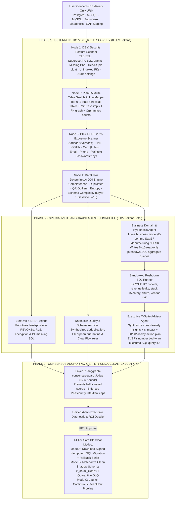

# Plan 06 — "One-Click DB X-Ray, Clear & Executive Advisor" MVP Plan
**Addresses `sprint1.md` Item 9:**
- *Item 9:* "If we are sorted with the million-rows table and multiple-table issue, why don't we introduce something like One-Click DB Clear — suppose there is a company with lots of data in their ERP DB or any DB. Our intelligence system will first analyse the DB overall, then tables, then data in those tables by our innovative table-reading technique, suggest security fixes, PII issues, data quality issues (powered by DataGlow), and lastly generate business insights by reading the whole data plus give suggestions as a business leader and advisor. This could be an MVP feature done by agentic orchestration with a proper pipeline."

---

## 1. Strategic Assessment: Why This Could Be DataX's #1 Wedge Product

This is **the strongest commercial wedge idea in the entire backlog** — provided we get one product-safety detail right:

> **Critical Enterprise Naming & Safety Rule ("X-Ray First, Staged Clear Second"):**  
> Never market or execute *"One-Click DB Clear"* as an immediate destructive `UPDATE / DELETE` on a live production ERP! No DBA or CISO will connect production credentials to a button that mutates tables on click.  
> Instead, frame the workflow as **"1-Click DB X-Ray $\to$ Verified 1-Click Safe Clear (Dry-Run Diff + Shadow Clean Schema / Transactional Migration Script with Instant Rollback)."**  
> Day-1 onboarding requires **ONLY a `READ-ONLY` database user** — cutting enterprise security approval from 3 months to **15 minutes**!

### Why Enterprises Will Pay Immediately for This Single Feature
Today, getting the output you just described takes an enterprise **4 separate tools + a McKinsey/Big-4 engagement**:
1. **Database Security Posture** (*Wiz / Normalyze*) +
2. **PII & DPDP 2025 Discovery** (*BigID / Securiti*) +
3. **Data Quality Index & Remediation** (**DataGlow** `MetricEngine` + `langgraph-consensus-guard`) +
4. **SQL-Grounded Executive Business Diagnostic** (*BI / Strategy Consultant*).

Delivering all four in **one 3-minute autonomous scan on a read-only DB connection — costing <₹15 in LLM tokens via Plan 05's Sketch-Pushdown engine** — creates an unforgettable "aha!" demo that converts prospects on the first call.

---

## 2. End-to-End Agentic Orchestration Pipeline (LangGraph + DataGlow + Consensus Guard)

---

## 3. What Each of the 4 Output Pillars Concrete Checks & Delivers

### Pillar A — Database Security & Infrastructure Health
- **Transport & Auth:** SSL/TLS enforcement check (`pg_stat_ssl`), password hash column sanity (detecting plaintext or weak MD5 passwords stored in `users` tables!).
- **Privilege Over-Exposure:** Tables granting `SELECT/INSERT/DELETE` to `PUBLIC`, app service accounts running as `rds_superuser` / `rolsuper`, missing Row-Level Security (RLS) on multi-tenant tables (`tenant_id` column present without RLS policy).
- **Structural & Performance Debt:** Tables missing Primary Keys (breaks CDC/replication), Foreign Keys missing B-Tree indexes (causes lock contention), table bloat / dead-tuple ratio $>25\%$, unused indexes wasting write IOPS.
- **1-Click Output:** Ready-to-run, copyable `REVOKE` / `CREATE INDEX CONCURRENTLY` / `ENABLE ROW LEVEL SECURITY` SQL script.

### Pillar B — PII, Secrets & India DPDP 2025 / GDPR Risk Map
- **High-Precision Detection:** Column-header semantics + cell-sample checksum validation (**Aadhaar Verhoeff**, **PAN**, **GSTIN Mod-36**, **Credit Card Luhn**, **SSN**, **UPI VPA**, **IFSC**, **JWT/API keys** stored accidentally in `logs`/`audit`/`webhook_payloads` JSONB columns — a classic hidden breach vector!).
- **Blast-Radius Scoring:** Cross-references PII columns with `role_table_grants` + row counts (e.g., *"CRITICAL: `customers.aadhaar_no` contains ~142,000 unmasked Aadhaar numbers accessible to 6 non-admin DB roles — ₹250 Cr DPDP safeguard exposure"*).
- **1-Click Output:** Masking views, deterministic join-preserving tokenization via DataX `vault.py`, and retention/erasure SQL for stale dormant accounts (DPDP storage-limitation mandate).

### Pillar C — DataGlow-Powered Data Quality & Multi-Table Integrity ("DB Clear")
- **Reuses `nexlayer-backend/metrics/` + `langgraph-consensus-guard`:** Computes deterministic DQI per table and database-wide, anchored within $\pm 2.5$.
- **Cross-Table Relational Defects (via Plan 05 Tier 2):**
  - Orphan records (`1,840 invoice_items` pointing to non-existent `invoices`),
  - Duplicate customers/vendors across slight spelling/phone variations,
  - Accounting/formula violations (`total != qty * unit_price - discount`, negative inventory, `shipped_at < created_at`),
  - Zombie/abandoned tables (`0` writes in 180 days).
- **1-Click Safe Clear Execution (3 User-Selectable Modes):**
  1. **Export Verified SQL Pack (Zero Write Access Needed):** Generates a transactional `.sql` migration file (`BEGIN; ... SAVEPOINT ...;`) that archives bad rows to `datax_quarantine_*`, deduplicates, normalizes formats, and includes a `rollback.sql`.
  2. **Materialize Clean Shadow Database/Schema:** Writes 100% clean, repaired, PII-tokenized tables into `<schema>_clean` + routes violations into DataX Quarantine Workbench ([`staging.py` ARC-01](file:///h:/AAVIL%20Inc/DataX/DataX/backend/pipeline/staging.py)).
  3. **Promote to Scheduled CleanFlow Thread:** Converts the discovered rules into a continuous scheduled DataX Thread in 1 click!

### Pillar D — Hallucination-Proof Business Leader & Executive Advisor
**How we stop the "AI Business Advisor" from giving generic ChatGPT fluff:**
1. **Domain Classification First:** From table/column topology, the agent classifies the business model (e.g., *B2B Procurement / Manufacturing ERP*, *D2C E-Commerce*, *Subscription SaaS*, *Lending/Fintech*, *Hospital/EMR*).
2. **Mandatory Hypothesis $\to$ SQL Grounding Rule:** The Executive Advisor **is forbidden from stating any business insight without citing the `query_id` of an aggregate pushdown SQL query executed in Node `SQL`!**
   - *Example Real Pushdown Queries Generated Automatically:*
     - Revenue leakage: `SELECT status, COUNT(*), SUM(total_amount) FROM orders WHERE payment_status='PAID' AND fulfillment_status='FAILED' GROUP BY 1`
     - Working-capital trap: Top 10 slow-moving SKU categories sitting $>90$ days in inventory; vendors with highest price variance (`STDDEV(unit_price)/AVG(unit_price)`) for the same material!
     - Customer concentration / churn cohort: % of revenue from top 5% customers; month-over-month repeat order drop-off.
     - Dirty-data dollar cost: Exact ₹/\$ value of orders currently blocked or misstated due to the quality errors found in Pillar C!
3. **Executive Output Structure:**
   - **Executive Scorecard:** Overall DB Readiness (`0–10` anchored), Security Grade, DPDP/PII Risk, Data Quality Index, and **Quantified ₹/\$ Value at Risk**.
   - **Top 5 Board-Level Insights** (each with clickable *"View Executed SQL & Aggregate Proof"* badge).
   - **30-60-90 Day Prioritized Action Roadmap** split by owner (*CTO/DBA*, *CISO/DPO*, *CFO/COO*).

---

## 4. MVP Scope & 3-Week Sprint Plan

| Week | Deliverable | Key Files / Modules |
| :--- | :--- | :--- |
| **Week 1** | **Plan 05 Core + DB Security & DPDP Scanner:** PostgreSQL + MySQL + MSSQL read-only connector, Tier 0–2 Sketch & MinHash Join Engine, DB Security Posture rules, Indian + Global PII checksum scanner. | `backend/db_xray/catalog_harvester.py`, `sketch_profiler.py`, `security_posture.py`, `dpdp_pii_scanner.py` |
| **Week 2** | **DataGlow DQI Integration + LangGraph 6-Node Orchestrator:** Port `nexlayer-backend/metrics/` + `langgraph-consensus-guard`, build Sandboxed Pushdown SQL Hypothesis Runner (`sqlglot` AST guard + `READ ONLY` tx) + Executive Advisor + Safe Clear SQL/Shadow generator. | `backend/db_xray/orchestrator_graph.py`, `business_advisor.py`, `safe_clear_compiler.py`, SSE progress stream `/db-xray/run` |
| **Week 3** | **"1-Click DB X-Ray & Clear" Frontend Experience + Golden Demo DB:** Dedicated launchpad screen (`src/pages/DbXrayPage.jsx`): paste URI $\to$ live 6-stage radar progress $\to$ 4-tab Interactive Report (Security, PII/DPDP, DataGlow Quality, Executive Advisor) + 1-Click Safe Clear modal + PDF Executive Dossier export. | `src/pages/DbXrayPage.jsx`, `src/components/dbxray/*`, seeded 250k-row realistic dirty ERP demo DB for instant zero-setup trials |

---

## 5. Required Research & Validation Before Building

1. **DB Security Benchmark Mapping (CIS PostgreSQL / MSSQL / MySQL Benchmarks — 2 days):**
   - Map our 20 automated `Node 1` checks directly to **CIS Benchmark IDs** (e.g., `CIS PostgreSQL 16 Benchmark §4.x / §6.x`) and **India DPDP Rules 2025 reasonable security safeguards** so every finding carries an authoritative compliance citation.
2. **Non-Hallucinating Business Insight Prompt & `sqlglot` Guardrail Testing (3 days):**
   - Test the Hypothesis $\to$ Pushdown SQL $\to$ Executive Advisor loop across 3 diverse open schemas (**AdventureWorks / Northwind ERP**, **Olist Brazilian E-Commerce 100k orders**, **Synthetic Hospital/BFSI DB**) and verify:
     - $0\%$ invalid/destructive SQL execution,
     - $100\%$ of numerical claims in the Executive Memo match the exact SQL query result JSON (automated citation verifier!),
     - Total token usage $< 15,000$ tokens per full database scan.
3. **Safe Remediation Transaction Semantics Research (2 days):**
   - Design idempotent SQL generation patterns for Postgres/MSSQL/MySQL that handle FK cascade ordering (archiving child orphans before parent deduplication) so generated `safe_clear.sql` scripts execute cleanly inside a single rollback-safe transaction.
